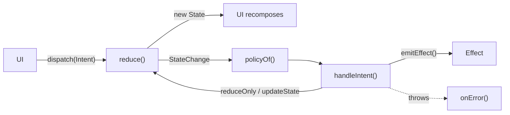

# Pulse

A small Kotlin Multiplatform MVI library, made for Compose Multiplatform.

- **A pure reducer** owns the state: `(state, intent) -> state`.
- **Side effects** run in coroutines, with a policy per intent (drop a double tap, keep only the latest load, queue, debounce).
- **One-shot effects** for navigation and toasts, delivered once and never while the screen is hidden.
- **Components**: state-only pieces that nest in a screen, in each other, or run alone.
- **A test kit** that drives your real ViewModel.

The core depends on `kotlinx-coroutines-core` and nothing else.

## Modules

All modules target JVM, Android, iOS, JS and WasmJS.

| Module | What it holds | Depends on |
|---|---|---|
| `pulse` | The engine (`Container`), contracts, components. | coroutines |
| `pulse-viewmodel` | `PulseViewModel`, the `SavedStateHandle` saver. | `pulse`, AndroidX lifecycle |
| `pulse-compose` | Collecting state and effects, `rememberReducer`, `rememberContainer`. | `pulse`, Compose runtime |
| `pulse-test` | The test kit. | `pulse`, coroutines-test |

## Installation

```kotlin
// settings.gradle.kts
repositories {
    maven("https://maven.bitsycore.com/releases")
}

// build.gradle.kts
kotlin {
    sourceSets {
        commonMain.dependencies {
            implementation("com.bitsycore.lib:pulse:0.4.1")
            implementation("com.bitsycore.lib:pulse-viewmodel:0.4.1")
            implementation("com.bitsycore.lib:pulse-compose:0.4.1")
        }
        commonTest.dependencies {
            implementation("com.bitsycore.lib:pulse-test:0.4.1")
        }
    }
}
```

<details>
<summary>Fallback repository: GitHub Packages</summary>

GitHub Packages requires authentication, even for public packages:

```kotlin
repositories {
    maven("https://maven.pkg.github.com/bitsycore/pulse-mvi") {
        credentials {
            username = providers.gradleProperty("gpr.user").orNull ?: System.getenv("GITHUB_ACTOR")
            password = providers.gradleProperty("gpr.token").orNull ?: System.getenv("GITHUB_TOKEN")
        }
    }
}
```

</details>

## Quick start

### 1. The contract

The state, the intents, the effects, and the pure reducer that is the single source of truth for the state.

```kotlin
object CounterContract : ContainerContract<CounterContract.UiState, CounterContract.Intent, CounterContract.Effect>() {

    data class UiState(val count: Int = 0, val saving: Boolean = false)

    sealed interface Intent {
        data object Increment : Intent
        data object Save : Intent
        data object Saved : Intent
    }

    sealed interface Effect {
        data class ShowToast(val message: String) : Effect
    }

    override fun reduce(state: UiState, intent: Intent): UiState = when (intent) {
        Intent.Increment -> state.copy(count = state.count + 1)
        Intent.Save -> state.copy(saving = true)
        Intent.Saved -> state.copy(saving = false)
    }
}
```

### 2. The ViewModel

The side effects: what an intent does besides changing the state.

```kotlin
class CounterViewModel(private val repository: Repository) : PulseViewModel<UiState, Intent, Effect>(CounterContract, UiState()) {

    // A double tap saves once.
    override fun policyOf(intent: Intent) = when (intent) {
        Intent.Save -> IntentPolicy.DropIfRunning()
        else -> IntentPolicy.Parallel
    }

    override suspend fun handleIntent(intent: Intent) {
        when (intent) {
            Intent.Save -> {
                repository.save(state.count)
                reduceOnly(Intent.Saved)
                emitEffect(Effect.ShowToast("Saved"))
            }
            else -> Unit
        }
    }

    // A failing side effect is reported, and the screen lives on.
    override fun onError(intent: Intent?, error: Exception) {
        reduceOnly(Intent.Saved)
        emitEffect(Effect.ShowToast("Could not save"))
    }
}
```

### 3. The screen (Compose)

```kotlin
@Composable
fun CounterScreen(viewModel: CounterViewModel = viewModel { CounterViewModel(repository) }) {
    val state by viewModel.collectAsStateWithLifecycle()
    viewModel.collectEffect { effect ->
        when (effect) {
            is Effect.ShowToast -> { /* show snackbar */ }
        }
    }
    CounterContent(state, viewModel::dispatch)
}

@Preview @Composable
private fun CounterPreview() {
    val (state, dispatch) = rememberReducer(CounterContract, UiState())
    CounterContent(state, dispatch)
}
```

## Core concepts

### Container

`Container` is the MVI engine, with no dependency but coroutines. `PulseViewModel` is a container living in a ViewModel; everything below is available in both.



| Hook (override) | When |
|---|---|
| `reduce(state, intent)` | Pure and synchronous, at every dispatch. Defaults to the contract's reducer. |
| `handleIntent(intent)` or `handleIntent(intent, change)` | The side effect, in a coroutine, after the reducer. `change.previous` / `change.current` / `change.changed` say what the reducer just did, so a side effect can tell "I set busy" from "busy was already set". |
| `policyOf(intent)` | How that side effect runs next to the ones already running (see below). |
| `onStart()` | Once, at the first collection of `stateFlow` or the first `dispatch`. Never at construction. |
| `whileActive()` | While someone collects `stateFlow`; cancelled `inactiveGrace` (5 s) after the last collector left, started again at the next one. Timers, polling, listeners. |
| `onError(intent, error)` | What a reducer, a side effect or a job threw. Rethrows by default (fail fast); override to report and keep running. `intent` is null when no intent was behind it. |

| Tool (call) | What |
|---|---|
| `state` | The current state. |
| `dispatch(intent)` | Reduce, then the side effect. |
| `reduceOnly(intent)` | Reduce only: a result coming back from async work goes through the reducer without starting another side effect. |
| `updateState("name") { copy(...) }` | Changes the state outside the reducer; the optional name is what an observer sees. |
| `emitEffect(effect)` | A one-shot event (navigation, a toast). |
| `launchLatest(key) { }` | A job; the one still running under that key is cancelled. |
| `launchOnce(key) { }` | A job, unless one is still running under that key. |
| `launchQueued(key) { }` | A job, after the ones already under that key. |
| `launchDebounced(key, delay) { }` | Like `launchLatest`, after a quiet delay. |
| `cancelJob(key)`, `isRunning(key)` | Cancels every job under a key; says whether one is running. |

### Intent policies

The reducer always runs, at once, for every dispatch. A policy decides on the side effect only.

| Policy | Side effect |
|---|---|
| `Parallel` (default) | One coroutine per dispatch, in no particular order. |
| `DropIfRunning(key)` | Skipped while the previous one runs: a double tap prints once. |
| `Latest(key)` | Cancels the previous one: a slow load cannot land after a newer one. |
| `Queue(key)` | After the previous ones, in dispatch order. |
| `Debounce(delay, key)` | `Latest`, after a quiet delay: the text field updates at each key, the search runs once. |

A null key means "this intent's class"; intents given the same key share one lane.

An intent can say its own policy where it is declared, by being a `PolicedIntent`:

```kotlin
sealed interface Intent {
    data object Print : Intent, PolicedIntent by IntentPolicy.DropIfRunning()
    data class SelectScope(val scope: Scope) : Intent, PolicedIntent by IntentPolicy.Latest("load")
    data class QueryChanged(val query: String) : Intent, PolicedIntent by IntentPolicy.Debounce(300.milliseconds)
    data object Refresh : Intent   // Parallel
}
```

That is the default only. `policyOf` has the final word, for a policy that depends on the state or on the ViewModel:

```kotlin
override fun policyOf(intent: Intent) = when (intent) {
    is Intent.Print -> IntentPolicy.DropIfRunning()
    is Intent.SelectScope -> IntentPolicy.Latest("load")
    is Intent.QueryChanged -> IntentPolicy.Debounce(300.milliseconds)
    else -> IntentPolicy.Parallel
}
```

### Effects

Each effect is delivered exactly once, and kept while nobody collects. They are meant for a single collector: two collectors would share the effects between them.

### Observer

`PulseObserver` sees every intent (with the state before and after), every named state update, every effect and every error: a log, a journal, a debugger. Set one for the whole app, or give one to a container.

```kotlin
Pulse.observer = object : PulseObserver {
    override fun onIntent(source: Any, intent: Any, previous: Any, current: Any) =
        log("${source::class.simpleName}: ${intent::class.simpleName}")
    override fun onError(source: Any, intent: Any?, error: Exception) = report(error)
}
```

### A container without a ViewModel

```kotlin
val container = Container(MyContract, MyContract.UiState(), coroutineScope) { intent, change ->
    // this: ContainerScope (state, reduceOnly, emitEffect, launchLatest, ...)
}
```

or subclass `Container` and override the hooks.

## Saved state

A container keeps its state across its death through a `StateSaver`; without one it keeps nothing. `pulse-viewmodel` ships one over `SavedStateHandle`. How the state is written is yours (JSON, a subset, a sealed form), and it is encoded only when the platform asks for the saved state, not at every change.

```kotlin
class MyViewModel(handle: SavedStateHandle) : PulseViewModel<UiState, Intent, Effect>(
    MyContract, UiState(),
    saver = handle.stateSaver(
        encode = { Json.encodeToString(UiState.serializer(), it) },
        decode = { Json.decodeFromString(UiState.serializer(), it) },
    ),
)

// In Compose:
val viewModel: MyViewModel = viewModel { MyViewModel(createSavedStateHandle()) }
```

For anything else (a file, a database), implement `StateSaver`: `restore()`, and `onStateChanged(state)` or `bind(current)`.

## Compose extensions

| Function | What it does |
|---|---|
| `host.collectAsStateWithLifecycle()` | The state, collected while the lifecycle is at least STARTED. |
| `host.collectEffect { }` | The effects, handled while the lifecycle is at least STARTED. One emitted while the app is in the background, or the screen under another one, waits for the return. |
| `host.collectEffectAlways { }` | The effects, whatever the lifecycle. |
| `PulseScreen(host, onEffect = { }) { state, dispatch -> }` | The two above and the content, in one call. |
| `rememberReducer(reducer, initialState)` | A state and its pure reducer held by the composition: a component used alone, a `@Preview` that reacts. |
| `rememberContainer(contract, initialState) { intent, change -> }` | A container that lives with the composition, where there is no ViewModel: a dialog, a widget, a desktop window. |
| `host.onLifecycleIntent { onResume { Intent.X } }` | An intent at a lifecycle event. Most of the time `onStart` and `whileActive` in the ViewModel say the same without the screen. |
| `host.onCompositionIntent { onEnter { }; onExit { } }` | An intent when the caller enters and leaves the composition. |

## Components

A `ComponentContract` is a reusable piece of state with its own intents and pure reducer, and nothing else: no effects, no coroutines. Whoever holds it keeps its state, hands it its intents, and does the async work its intents ask for.

```kotlin
object ColorPicker : ComponentContract<ColorPicker.State, ColorPicker.Intent>(State()) {
    data class State(val red: Float = 0f, val green: Float = 0f, val blue: Float = 0f)
    sealed interface Intent {
        data class SetRed(val value: Float) : Intent
        data object Confirm : Intent
    }
    override fun reduce(state: State, intent: Intent): State = when (intent) {
        is Intent.SetRed -> state.copy(red = intent.value.coerceIn(0f, 1f))
        Intent.Confirm -> state
    }
}

@Composable
fun ColorPickerContent(state: ColorPicker.State, dispatch: (ColorPicker.Intent) -> Unit) { /* pure UI */ }
```

**Inside a screen**: a field, a wrapping intent, one reducer line.

```kotlin
data class UiState(val picker: ColorPicker.State = ColorPicker.initialState)
sealed interface Intent { data class Picker(val intent: ColorPicker.Intent) : Intent }

override fun reduce(state: UiState, intent: Intent) = when (intent) {
    is Intent.Picker -> state.copy(picker = ColorPicker.reduce(state.picker, intent.intent))
}

// UI
ColorPickerContent(state.picker) { dispatch(Intent.Picker(it)) }
```

**The parent reacts to its child** by matching the wrapped intent, in its reducer or in its side effects. That is how a pure component asks for async work:

```kotlin
override suspend fun handleIntent(intent: Intent) {
    when (intent) {
        is Intent.Picker -> if (intent.intent == ColorPicker.Intent.Confirm) repository.save(state.picker)
    }
}
```

**Inside another component**: the same three pieces, since a contract and a component are both a `Reducer`. A contract can be embedded as a component too.

**Alone**, with no parent: `val (state, dispatch) = rememberReducer(ColorPicker)`.

**Slots** (experimental) declare once where a child lives in its parent. They earn their keep with a list of children, each found by its id:

```kotlin
private val ROWS = listSlot(Row, UiState::rows, { state, rows -> state.copy(rows = rows) }) { it.id }

is Intent.Row -> ROWS.reduce(state, intent.id, intent.intent)   // one child
Intent.ResetAll -> ROWS.reduceAll(state, Row.Intent.Reset)      // every child
```

`slot(...)` does the same for a single child.

## Testing

`pulse-test` drives a real host (your ViewModel, a container) from inside `runTest`. Every `expect...` first runs what is due now, never the clock: timers and debounces move only with `advanceBy`.

```kotlin
@Test
fun aDoubleTapSavesOnce() = runTest {
    Dispatchers.setMain(StandardTestDispatcher(testScheduler))   // for a ViewModel
    CounterViewModel(FakeRepository()).test(this) {
        dispatch(Intent.Save)
        dispatch(Intent.Save)
        expectState { it.saving }
        expectEffect<Effect.ShowToast>()
        expectNoEffects()
        expectState { !it.saving }
    }
}
```

| In the block | What it does |
|---|---|
| `dispatch(intent)` | Sends an intent to the host. |
| `state`, `states` | The state now; every state since the test began. |
| `expectState(expected)`, `expectState { predicate }` | Checks the state, once what is due has run. |
| `expectEffect<T>()`, `expectEffect(expected)`, `nextEffect()` | The next effect not yet looked at. |
| `expectNoEffects()` | Fails if an effect is waiting. |
| `settle()`, `advanceBy(duration)` | Run what is due now; move the clock. |

A reducer is a pure function, a component too: test them by calling `reduce`.

`TestContainer` and `containerTest` build a container out of lambdas, for testing without a ViewModel; they reduce through the contract's own reducer unless given another.

## Migrating from 0.3

See [MIGRATION.md](MIGRATION.md).

## Build

```bash
./gradlew build                    # Build all modules
./gradlew :pulse:build             # Build core only
./gradlew :pulse-test:jvmTest      # Run tests
./gradlew :demo:run                # Run desktop demo app
```

## License

[MIT](LICENSE.md)
